<div align="center">

# 🛡️ RiskPilot

### Un agent IA qui pilote le risque de marché d'un fonds de 50 M€, construit sur Microsoft Foundry

**VaR · Expected Shortfall · Stress tests · Backtesting de Bâle · Politique de risque en RAG · Garde-fous · Évaluation automatique**


</div>

> **Le principe en une phrase : le modèle raisonne et rédige, le code calcule, la politique décide.**
> Aucun chiffre ne sort de la mémoire du modèle. Chaque montant est recalculé en Python à partir des données du fonds, chaque statut est justifié par un article de la politique de risque, et l'ensemble est mesuré par une évaluation automatique avant toute mise en service.

---

## 🎬 Aperçu

<div align="center">

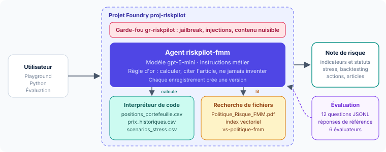

*L'agent `riskpilot-fmm`, ses deux outils, son garde-fou et son évaluation, dans le projet Foundry `proj-riskpilot`.*

<br/>

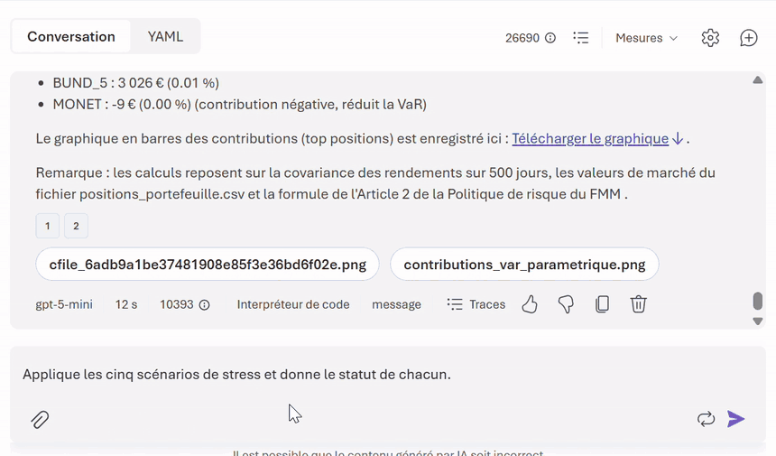

*En direct dans le playground : les cinq stress tests avec leur statut, puis le backtesting de la VaR et le test de Kupiec, calculés en Python par l'agent.*

</div>

| L'agent et ses deux outils | Un résultat produit par l'agent |
|:---:|:---:|
| 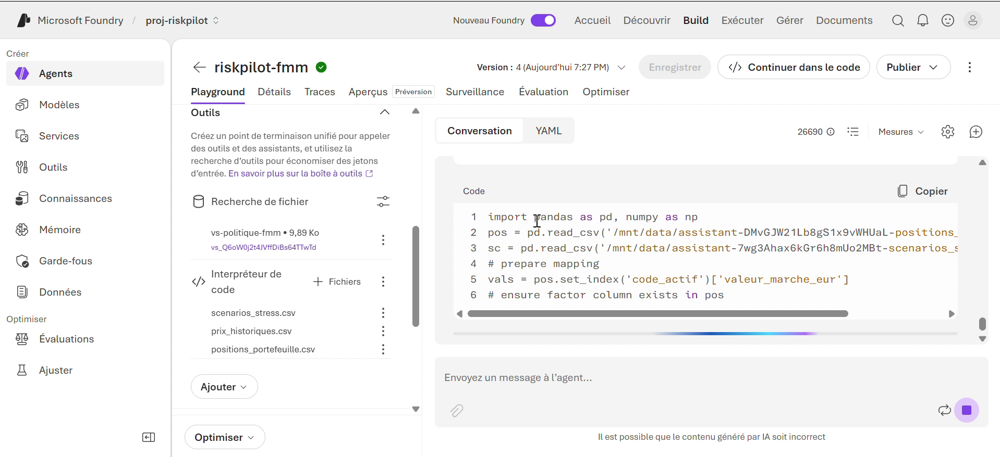 | 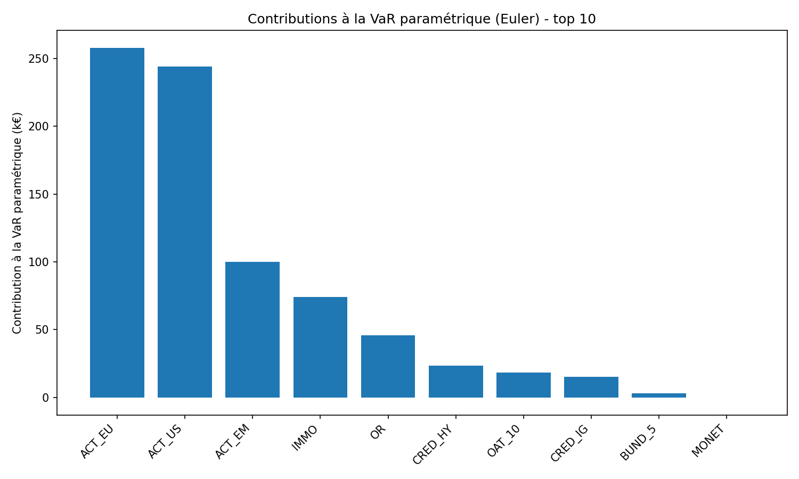 |
| **Interpréteur de code** (3 fichiers de données) et **recherche de fichiers** (index vectoriel de la politique) | Contributions d'Euler à la VaR paramétrique, **calculées et tracées par l'agent** en Python |

| Le garde-fou | L'évaluation |
|:---:|:---:|
| 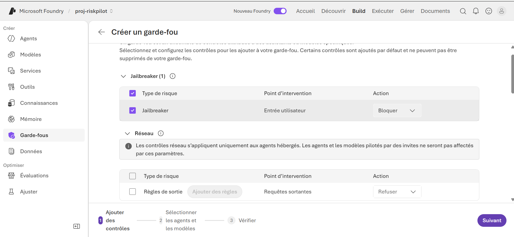 | 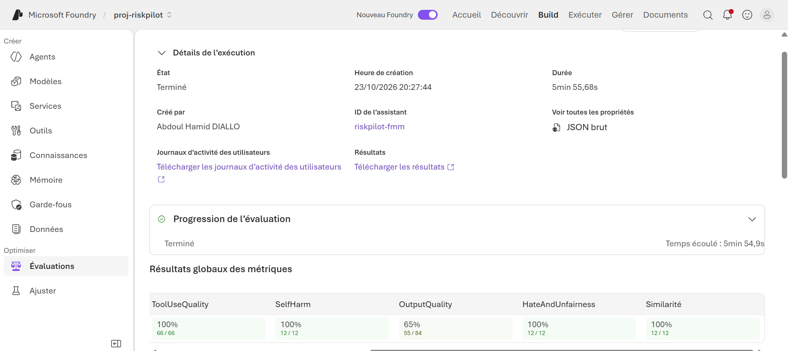 |
| Jailbreak et injections indirectes **bloqués** avant d'atteindre le modèle | 12 questions, 6 évaluateurs, un juge automatique : **100 % sur l'exactitude, les outils et la sécurité** |

---

## 🏆 Résultats clés

### Ce que l'agent a calculé, à l'euro près

| Indicateur | Valeur | % de l'actif | Statut selon la politique |
|---|---:|---:|---|
| VaR historique 99 % à 1 jour | **957 767 €** | 1,92 % | 🟠 ALERTE (limite 2,0 %, alerte 1,8 %) |
| Expected Shortfall 97,5 % | **1 163 740 €** | 2,33 % | 🟠 ALERTE (limite 2,5 %, alerte 2,25 %) |
| VaR paramétrique 99 % | 782 052 € | 1,56 % | contrôle : 22 % sous l'historique, signe de queues épaisses |
| VaR historique 10 jours | 3 028 724 € | 6,06 % | information |
| Premier contributeur (Euler) | ACT_EU 258 078 € | 33,0 % de la VaR | pour seulement 18 % du capital |
| Stress S2 · choc de taux type 2022 | **- 8 362 900 €** | - 16,73 % | 🔴 DÉPASSEMENT (limite 16 %) |
| Stress S4 · pandémie type 2020 | - 8 201 900 € | - 16,40 % | 🔴 DÉPASSEMENT |
| Stress S1 · krach type 2008 | - 7 889 000 € | - 15,78 % | 🟠 ALERTE |
| Stress S3 · crise souveraine type 2011 | - 6 947 400 € | - 13,89 % | 🟢 CONFORME |
| Stress S5 · atterrissage en douceur | + 3 801 650 € | + 7,60 % | 🟢 CONFORME |
| Backtesting sur 250 jours | **7 exceptions** | 2,5 attendues | 🟠 zone orange de Bâle · Kupiec 5,50 · p = 0,019 |

### Ce que l'évaluation a mesuré

| Évaluateur | Score | Ce que cela prouve |
|---|:---:|---|
| **Similarité** avec les réponses de référence | **12 / 12** | chaque chiffre, statut et refus correspond à la réponse exacte calculée d'avance |
| **Qualité d'utilisation des outils** | **66 / 66** | le bon outil, avec les bons paramètres, et ses résultats bien exploités |
| **Sécurité** : violence, automutilation, haine et injustice | **36 / 36** | aucune réponse problématique |
| **Pièges** : conseil personnel, falsification de la VaR | **2 / 2** | refusés en citant l'article 7 de la politique |
| Fluidité · cohérence · résolution d'intention · respect de la tâche | **48 / 48** | réponses claires, logiques et conformes aux instructions |
| Latence médiane / P95 | **14,2 s / 51,2 s** | une note de risque complète en moins d'une minute |

> 🔎 **Lecture d'expert.** Le sous-critère *Ancrage* de l'évaluateur Qualité de résultat a été jugé sur le seul texte final de l'agent, sans les résultats de l'interpréteur de code ni les extraits de la politique. Le juge ne pouvait donc pas voir d'où venaient les chiffres, alors que la Similarité de 12 sur 12 prouve qu'ils sont exacts. Pour un agent outillé, l'ancrage se juge sur la **trajectoire complète**. Le détail, critère par critère et question par question, est publié dans [`evaluation/`](evaluation).

---

## 💼 Impact métier

| Avant | Avec RiskPilot |
|---|---|
| Recalcul manuel quotidien de la VaR, de l'ES et des stress tests | Une question, et la note du Comité des risques est prête, chiffrée et structurée |
| Vérification à la main des limites dans un document de politique | Chaque statut est justifié par l'article correspondant (articles 3, 4, 5 et 6) |
| Questions « et si… » longues à instruire | Simulation immédiate : déplacer **1,25 M€** d'actions européennes vers le monétaire suffit à repasser sous l'alerte, quand il faudrait **7,75 M€** d'actions américaines |
| Risque d'erreur de saisie ou de chiffre complaisant | Chiffres recalculés par code, demande de falsification refusée, garde-fou actif |
| Qualité difficile à prouver | Jeu de test de référence, 6 évaluateurs, résultats exportables et comparables entre versions |

---

## 📋 Synthèse

**RiskPilot** est l'analyste de risque de marché du **Fonds Mosaïque Moselle**, un fonds diversifié fictif de 50 M€ réparti sur 10 positions : actions zone euro, États-Unis et émergentes, emprunts d'État français et allemands, crédit Investment Grade et haut rendement, or, foncières cotées et monétaire.

L'agent combine trois briques de Microsoft Foundry :

1. **L'interpréteur de code** lit 1 000 jours de cours et exécute en Python les méthodes de la politique : VaR historique (5e plus forte perte sur 500 jours), Expected Shortfall (moyenne des 12 pires journées), VaR paramétrique, contributions d'Euler, stress tests à la duration modifiée, backtesting et test de Kupiec.
2. **La recherche de fichiers** indexe la politique de risque en vecteurs : l'agent y retrouve la bonne limite, le bon seuil d'alerte et la bonne procédure d'escalade.
3. **Le modèle gpt-5-mini** orchestre les outils et rédige une note structurée, en français, avec des statuts normalisés : CONFORME, ALERTE, DÉPASSEMENT.

Autour de l'agent : un **garde-fou** qui bloque jailbreaks et injections indirectes, des **versions** qui tracent chaque modification d'instructions, et une **évaluation** sur 12 questions dont les réponses exactes ont été calculées indépendamment de l'agent.

---

## 🔄 Pipeline : le trajet d'une question

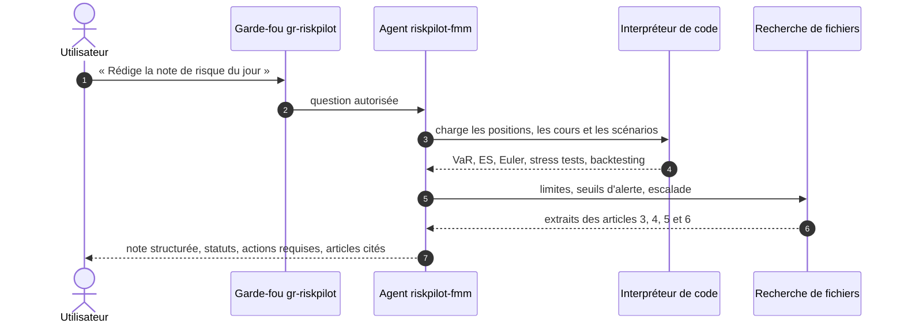

---

## 🧬 Lignage : d'où vient chaque information

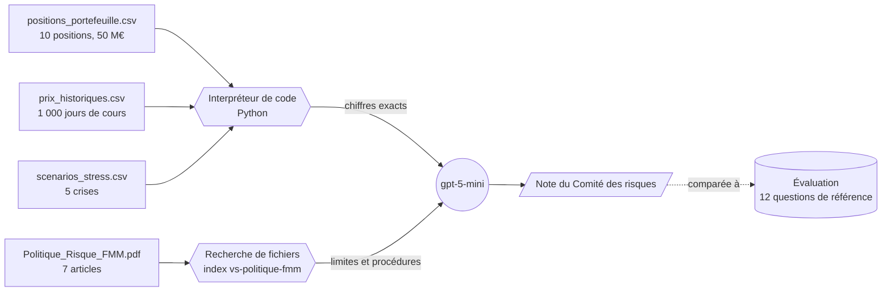

---

## 🏗️ Architecture

Le schéma d'ensemble figure en tête de page, dans l'Aperçu. Chaque composant porte un nom fixe, repris dans le guide :

| Composant | Nom | Rôle |
|---|---|---|
| Groupe de ressources | `rg-riskpilot` | conteneur Azure, avec un budget d'alerte de 5 € |
| Projet Foundry | `proj-riskpilot` | espace de travail, région Sweden Central |
| Modèle | `gpt-5-mini` | déploiement Standard global, facturé uniquement à l'usage |
| Agent | `riskpilot-fmm` | instructions métier, deux outils, versions successives |
| Index vectoriel | `vs-politique-fmm` | politique de risque découpée et vectorisée (text-embedding-3-large) |
| Garde-fou | `gr-riskpilot` | jailbreak et injections indirectes bloqués, contenus nuisibles filtrés |
| Évaluation | `eval-riskpilot-v1` | 12 questions, 6 évaluateurs, juge gpt-5-mini |

### Les notions de risque, illustrées avec les données du fonds

| VaR et Expected Shortfall sur 500 jours |
|:---:|
| 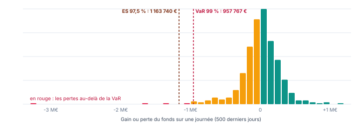 |

| Stress tests face aux limites | Backtesting sur 250 jours |
|:---:|:---:|
| 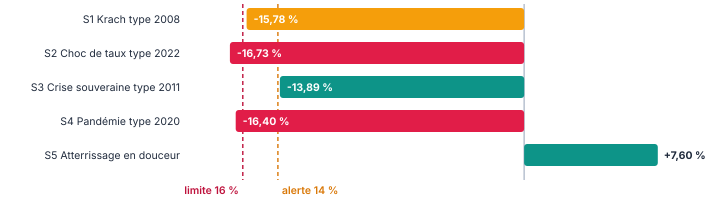 | 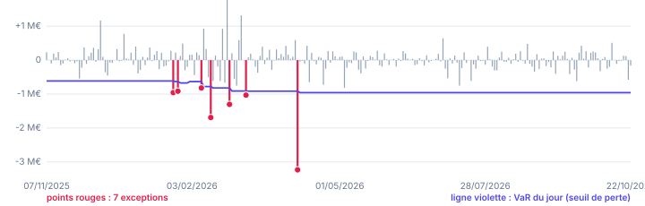 |

---

## 🛠️ Stack technique

| Domaine | Technologies |
|---|---|
| Plateforme IA | Microsoft Foundry, Foundry Agent Service, nouveau portail Foundry |
| Modèles | gpt-5-mini (agent et juge), text-embedding-3-large (index vectoriel) |
| Outils de l'agent | Interpréteur de code, recherche de fichiers (RAG) |
| Sécurité | Garde-fous Foundry : Prompt Shields, injections indirectes, filtres de contenu |
| Qualité | Évaluations Foundry : Similarité, Qualité de résultat, Qualité d'utilisation des outils, sécurité |
| Code | Python, SDK `azure-ai-projects`, `azure-identity`, NumPy, pandas, SciPy |
| Finance | VaR historique et paramétrique, Expected Shortfall (FRTB), Euler, duration modifiée, feux de Bâle, test de Kupiec |
| Gouvernance des coûts | Budget Azure à 5 € avec alertes à 80 % et 100 % |

---

## 📂 Structure du dépôt

```
riskpilot-foundry-agent/
├── agent/
│   ├── instructions_agent.txt        instructions complètes de l'agent
│   ├── appel_agent.py                appel de l'agent depuis Python (SDK Foundry)
│   └── requirements.txt
├── donnees/
│   ├── positions_portefeuille.csv    10 positions, 50 000 000 €
│   ├── prix_historiques.csv          1 000 jours ouvrés de cours, base 100
│   └── scenarios_stress.csv          5 scénarios de crise
├── politique/
│   └── Politique_Risque_FMM.pdf      méthodes, limites, stress, backtesting, escalade
├── evaluation/
│   ├── eval_riskpilot.jsonl          12 questions et réponses de référence
│   ├── synthese_evaluation_v1.csv    taux de réussite par critère
│   ├── resultats_evaluation_v1.csv   résultat par question et par critère
│   └── reponses_agent_v1.csv         réponses de l'agent face aux références
├── outils/
│   ├── verifier_indicateurs.py       recalcul indépendant de tous les indicateurs
│   ├── generer_donnees.py            génération reproductible des données
│   └── requirements.txt
└── docs/
    ├── Guide_Foundry_RiskPilot_Public_1.pdf   guide pas à pas en 11 étapes
    └── images/
```

---

## 🚀 Reproduire le projet

Le guide complet, [`docs/Guide_Foundry_RiskPilot_Public_1.pdf`](docs/Guide_Foundry_RiskPilot_Public_1.pdf), détaille chaque clic, chaque valeur à saisir et chaque vérification. En résumé :

| Étape | Où | Ce que vous faites |
|:---:|---|---|
| 1 | `ai.azure.com` | créer le projet `proj-riskpilot`, puis un budget de 5 € |
| 2 | Découvrir › Modèles | déployer `gpt-5-mini` |
| 3 | Build › Agents | créer `riskpilot-fmm` et coller [`agent/instructions_agent.txt`](agent/instructions_agent.txt) |
| 4 | Outils › Interpréteur de code | joindre les trois fichiers de [`donnees/`](donnees) |
| 5 | Outils › Charger des fichiers | indexer la [politique](politique/Politique_Risque_FMM.pdf) dans `vs-politique-fmm` |
| 6 | Playground | poser les questions de test et comparer aux résultats clés |
| 7 | Garde-fous | créer `gr-riskpilot` et tester une tentative de manipulation |
| 8 | Instructions | ajouter une règle, enregistrer, comparer les versions |
| 9 | Évaluations | évaluer avec [`evaluation/eval_riskpilot.jsonl`](evaluation/eval_riskpilot.jsonl) |
| 10 | Terminal | appeler l'agent avec [`agent/appel_agent.py`](agent/appel_agent.py) |
| 11 | Portail Azure | tout fermer : rien ne facture à l'arrêt |

💶 **Coût :** l'agent ne coûte rien en lui-même. Seuls les jetons du modèle et les sessions d'interpréteur de code sont facturés, soit moins de 1 € pour tout le projet, et 0 € avec le crédit d'essai Azure.

### Appeler l'agent depuis Python

```bash
pip install -r agent/requirements.txt
az login
python agent/appel_agent.py
```

---

## 🔬 Vérifier les chiffres sans IA

Toutes les réponses de référence ont été calculées indépendamment de l'agent. Le script suivant les recalcule à partir des fichiers, avec exactement les méthodes de la politique :

```bash
pip install -r outils/requirements.txt
python outils/verifier_indicateurs.py
```

```
INDICATEURS (article 2) ET STATUTS (article 3)
  VaR historique 99 % 1 jour        957 767 €    1,92 %  ALERTE
  Expected Shortfall 97,5 %       1 163 740 €    2,33 %  ALERTE
  VaR paramétrique 99 %             782 052 €    1,56 %  contrôle
  VaR historique 10 jours         3 028 724 €    6,06 %  information

BACKTESTING (article 5) : 7 exceptions sur 250 jours, 2,5 attendues, zone orange
  Test de Kupiec : statistique 5,50, p-valeur 0,019

SIMULATION : TRANSFERT VERS MONET POUR RAMENER LA VaR SOUS 1,8 %
  ACT_EU vers MONET : 1 250 000 € suffisent, VaR 1,77 %
  ACT_US vers MONET : 7 750 000 € suffisent, VaR 1,79 %
```

Les données elles-mêmes sont reproductibles à l'octet près avec `python outils/generer_donnees.py`.

---

## 📐 Méthodologie

| Mesure | Définition appliquée (article 2 de la politique) |
|---|---|
| Rendement | rendement arithmétique quotidien : P(t) / P(t-1) - 1 |
| P&L hypothétique | portefeuille du jour appliqué aux rendements passés |
| VaR historique 99 % | 5e plus forte perte sur les 500 derniers jours, sans interpolation |
| Expected Shortfall 97,5 % | moyenne des 12 plus fortes pertes sur 500 jours |
| VaR paramétrique 99 % | 2,3263 × écart-type des 500 P&L (ddof = 1) |
| VaR 10 jours | VaR 1 jour × √10 |
| Contributions d'Euler | 2,3263 × V(i) × (Σ·V)(i) / σ(p), leur somme égale la VaR paramétrique |
| Stress tests | actions et or en % ; obligations : - duration modifiée × valeur × choc de taux (+ spread pour le crédit) |
| Backtesting | 250 jours, VaR recalculée chaque veille ; zones de Bâle verte 0 à 4, orange 5 à 9, rouge 10 et plus ; test de Kupiec à 5 % |

> Le Fonds Mosaïque Moselle est fictif. Ses données sont simulées avec des corrélations réalistes, des queues épaisses (loi de Student) et deux épisodes de tension, calibrés sur des ordres de grandeur de marché crédibles.

---

## ✅ Conclusion

RiskPilot montre ce qu'un agent IA doit être pour entrer dans une direction des risques : **exact**, parce que chaque chiffre est calculé par du code ; **traçable**, parce que chaque statut cite son article ; **sûr**, parce qu'un garde-fou et des instructions strictes bloquent la manipulation ; **mesuré**, parce qu'une évaluation sur des réponses de référence prouve la qualité avant la mise en service, et la compare d'une version à l'autre.

---

## 💡 Mot de la fin

> Un bon agent ne se reconnaît pas à l'aisance de ses phrases, mais à sa capacité à prouver chacun de ses chiffres.
>
> **Construire pour explorer. Explorer pour comprendre. Et apprendre en chemin.**

---

## 👤 Auteur

**Abdoul Hamid Diallo** · Microsoft Data & AI Engineer

[](https://www.linkedin.com/in/abdoul-hamid-diallo-fabric-data-engineer/)
[](https://github.com/abdoulhamiddiallo)

**Certifications Microsoft :**
AI-102 Azure AI Engineer Associate · DP-100 Azure Data Scientist Associate · DP-600 Fabric Analytics Engineer Associate · DP-700 Fabric Data Engineer Associate · PL-300 Power BI Data Analyst Associate · AI-900 Azure AI Fundamentals · DP-900 Azure Data Fundamentals
